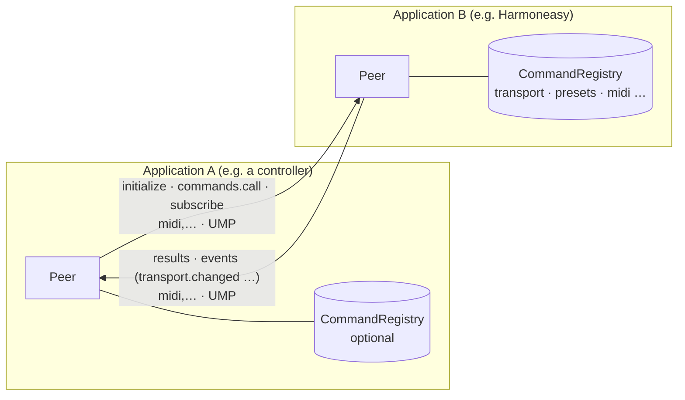
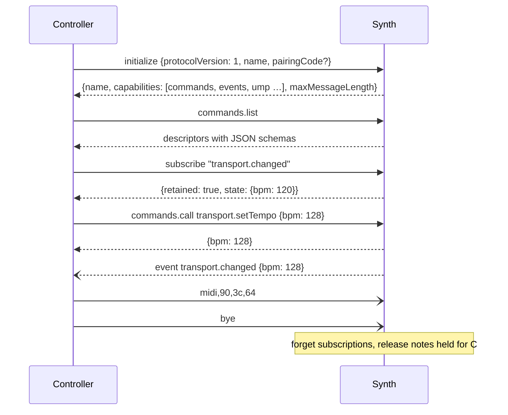
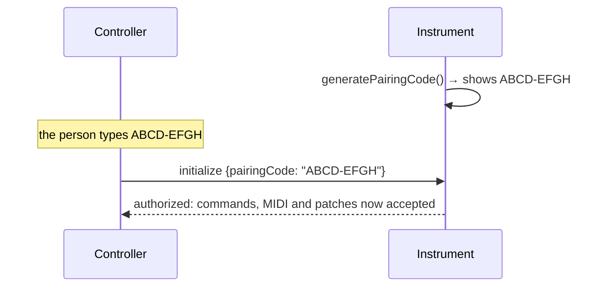
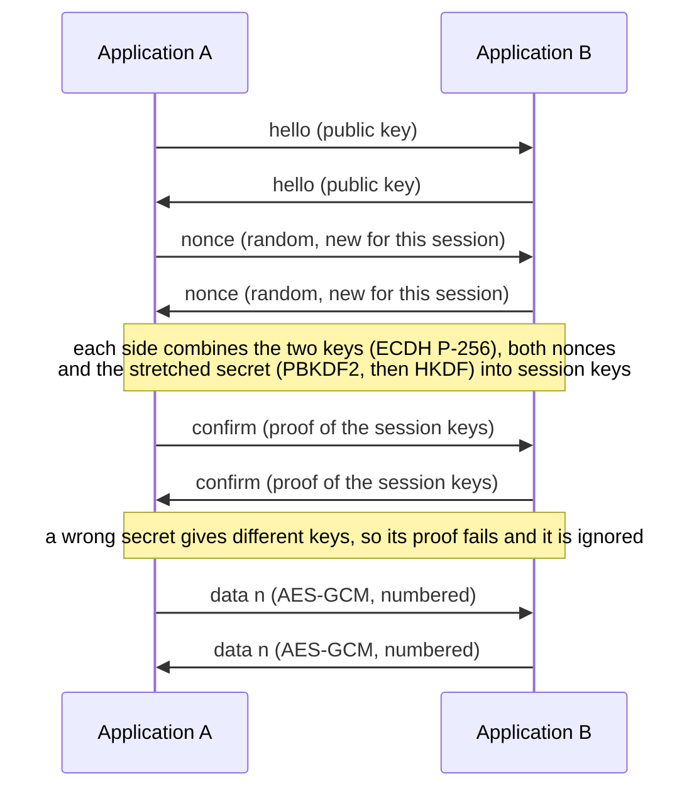

# audioBus Protocol

Let web music applications **find each other's commands, call them, follow each other's state and exchange MIDI**. Both sides run the same peer over `postMessage`, so either one can control the other. Plain [WebMidiLink](https://www.g200kg.com/en/docs/webmidilink/spec.html) `midi,…` messages still work unchanged.

**[Documentation and live demos](https://designerzen.github.io/audiobus-protocol/)** · **[Remote control Harmoneasy](https://designerzen.github.io/harmoneasy/protocol-remote.html)** · [Wire protocol](docs/protocol.md) · [Integration guide](docs/integration.md)

- No runtime dependencies, no DOM required. Works in any window, iframe or popup, and between cross-origin isolated apps over a MIDI port, WebRTC, a WebSocket or an extension.
- Commands are described with JSON schemas, so a remote can build forms and a command palette can share the same handlers.
- MIDI 1 bytes, negotiated MIDI 2 UMP, discoverable properties, retained state and pairing codes.



## Install

```sh
npm install git+https://github.com/designerzen/audiobus-protocol.git#main
```

Or `npm install ../audiobus-protocol` for a local checkout. The built `dist/` is committed, so Git installs work with install scripts disabled (`--ignore-scripts`). There is no npm release yet.

## Quick start

**1. The application being controlled** registers its commands and listens:

```js
import { CommandRegistry, Peer, windowTransport } from 'audiobus-protocol'

const commands = new CommandRegistry()
let bpm = 120

commands.register({
  id: 'transport.setTempo',
  title: 'Set tempo',
  description: 'Tempo in beats per minute',
  inputSchema: {
    type: 'object',
    properties: { bpm: { type: 'number', minimum: 10, maximum: 303 } },
    required: ['bpm'],
    additionalProperties: false
  },
  execute({ bpm: next }) {
    bpm = next
    commands.publish('transport.changed', { bpm })
    return { bpm }
  }
})
// Subscribers get the current state together with their subscription
commands.retain('transport.changed', () => ({ bpm }))

// The controller's window and its exact origin: here, the page that embeds us
const peer = new Peer(windowTransport(window.parent, 'https://controller.example'), {
  identity: { name: 'My synth', version: '1.0' },
  registry: commands,
  onMidi: bytes => synth.play(bytes)
})
```

**2. The controller** connects, discovers and calls:

```js
import { Peer, windowTransport } from 'audiobus-protocol'

const frame = document.querySelector('iframe')
const synth = new Peer(windowTransport(frame.contentWindow, new URL(frame.src).origin), {
  identity: { name: 'My controller', version: '1.0' },
  onEvent: (topic, data) => console.log(topic, data)
})

await synth.connect()                                   // retried every 250 ms until the timeout
const commands = await synth.discover()                 // [{id, title, inputSchema, available}, …]
const { state } = await synth.subscribeState('transport.changed')  // {bpm: 120}, then events
await synth.call('transport.setTempo', { bpm: 128 })    // validated against the schema remotely
synth.sendMidi([0x90, 60, 100])                         // note on, plain WebMidiLink
synth.sendMidi([0x80, 60, 0])
synth.close()                                           // the other side releases held notes
```

Neither side is a server: once connected, the synth can `call()` the controller's commands too, over the same connection.

## A session, step by step



On the wire every control message is one string, `control,<request|response|event|bye>,<URI-encoded JSON>`, alongside the original `midi,90,3c,64` messages. Details are in the [wire protocol](docs/protocol.md).

## Recipes

### Receive MIDI and state

```js
const peer = new Peer(transport, {
  identity: { name: 'Visualiser', version: '1' },
  onMidi: bytes => draw(bytes),                     // Uint8Array, one complete message
  onEvent: (topic, data) => topic === 'transport.changed' && setTempo(data.bpm),
  onClosed: () => reconnectLater(),                 // the other side closed or reloaded
  onError: (error, context) => console.warn(context, error)
})
```

### Reconnect when the other application reloads

A reload starts a new session. Make a new `Peer` each time, and keep trying until the other side is listening:

```js
async function connect() {
  for (;;) {
    const attempt = new Peer(windowTransport(frame.contentWindow, origin), {
      identity, timeoutMs: 4000, onClosed: () => connect()
    })
    try { await attempt.connect(); return attempt }
    catch { attempt.close(); await new Promise(resolve => setTimeout(resolve, 1500)) }
  }
}
frame.addEventListener('load', async () => { peer = await connect() })
```

### Properties: discoverable values

```js
commands.registerProperty({
  id: 'transport.tempo', title: 'Tempo', description: 'Internal tempo', unit: 'BPM',
  schema: { type: 'number', minimum: 10, maximum: 303 },
  get: () => bpm,
  set: value => { bpm = value },
  writable: () => clock.isLocal
})
commands.notifyProperty('transport.tempo')        // after a local change

// The other side
await peer.listProperties()                       // [{id, title, unit, schema, readOnly, …}]
await peer.subscribe('properties.changed')        // events of {id, value}
await peer.setProperty('transport.tempo', 128)    // validated, written, read back
```

### MIDI 2 (UMP)

Both peers opt in. `sendUmp()` sends exact 32-bit words and throws unless both sides advertised `ump`:

```js
const peer = new Peer(transport, { identity, ump: true, onUmp: words => play(words) })
await peer.connect()
if (peer.supports('ump')) {
  peer.sendUmp([0x40904000, 0xffff0000])          // MIDI 2 note on, 16-bit velocity
}
```

The SDK never converts between UMP and MIDI 1. That is up to the application.

### Cross-origin isolated apps (SharedArrayBuffer)

Apps that send `Cross-Origin-Opener-Policy: same-origin` for `SharedArrayBuffer` cannot reach another origin's popup or opener, so `windowTransport` has nothing to post to. Iframes still work. For separate pages, swap the transport and keep everything else:

```js
import { Peer, midiTransport, findMidiPort } from 'audiobus-protocol'

// Both apps open the same loopback port (loopMIDI, IAC Driver, snd-virmidi).
const access = await navigator.requestMIDIAccess({ sysex: true })
const { input, output } = findMidiPort(access, 'loopMIDI Port')
const peer = new Peer(midiTransport(input, output), { identity, registry: commands })
```

Anything on a MIDI port can read and send to it, so pass a `secret` both apps know, as in [secure channels](#secure-channels-for-isolated-apps). `socketTransport` wraps a WebSocket or WebRTC data channel, and `portTransport` a MessagePort from an extension. In Chromium, `Document-Isolation-Policy` keeps `SharedArrayBuffer` without cutting window references. [Cross-origin isolated applications](docs/isolation.md) compares every option, with headers and code.

### Pairing codes for windows you did not choose

`windowTransport` proves which window sent a message, not that a person meant to connect. When the peer is `window.opener` or an embedding parent, show a code and require it:

```js
import { generatePairingCode, formatPairingCode } from 'audiobus-protocol'

// Instrument (opened by someone else)
const code = generatePairingCode()
codeLabel.textContent = formatPairingCode(code)  // e.g. ABCD-EFGH
const peer = new Peer(windowTransport(window.opener, openerOrigin), {
  identity, registry: commands, requirePairingCode: code,
  onAuthorized: () => status('Paired')
})

// Controller (the person types the code it shows)
const instrument = new Peer(windowTransport(popup, instrumentOrigin), {
  identity, pairingCode: codeInput.value
})
await instrument.connect()
```

Until the code matches, MIDI and patches are ignored and every request is rejected. Five wrong codes lock the peer until it is replaced.



## Secure channels for isolated apps

A window knows which window and origin sent each message, so `windowTransport` can check both. A MIDI port, a socket relay or an extension port cannot: anything connected to the channel can send to it and read from it. Pass a secret that both applications know, and the transport encrypts and authenticates everything:

```js
import { Peer, midiTransport, findMidiPort, generatePairingCode, formatPairingCode } from 'audiobus-protocol'

// One application shows a code; the person types it into the other.
const secret = generatePairingCode(12)              // 60 random bits
codeLabel.textContent = formatPairingCode(secret)   // e.g. ABCD-EFGH-JKLM

const { input, output } = findMidiPort(await navigator.requestMIDIAccess({ sysex: true }), 'loopMIDI Port')
const peer = new Peer(midiTransport(input, output, { secret }), { identity, registry: commands })
```

`secureTransport(transport, { secret })` does the same for a WebSocket, a WebRTC data channel or an extension's MessagePort.

### The risks, and how the secret answers them

| Risk on a shared channel | Without a secret | With a secret |
| --- | --- | --- |
| Other software on the port reads notes, commands and replies | Everything is readable | Encrypted with AES-GCM under keys that only the two applications hold |
| Another sender injects commands or MIDI, or pretends to be either side | Possible on a MIDI port | Every message is authenticated; nothing is heard from a sender until it proves the secret |
| Someone records traffic and sends it again | Accepted again | Each direction numbers its messages, and a number is only accepted once and in order; every session has new keys, so a replayed handshake cannot restart the numbering |
| Another application takes over the session | Needs an accepted `initialize`, which a pairing code can guard | Only an application that proves the secret, and only when it starts or accepts a connection, such as after a reload |
| A pairing code is copied off the channel | `initialize` carries it in the clear | The secret never crosses the channel; each side only proves it knows it |
| Junk or oversized frames exhaust memory | Bounded either way: senders without a handshake get a few small reassembly slots | The same |
| Large messages are lost or arrive out of order on a socket | Queued in order and split into fragments either way | The same |

### How it works



Both sides add a fresh random nonce to every session, so its keys are new even when a recorded handshake is sent again, and recordings of one session do not help with another. The `initialize`, commands, events and MIDI then run inside the encrypted channel exactly as over `postMessage`; nothing else in the application changes. The [wire format](docs/protocol.md#secure-channels) is specified for other implementations.

### Choosing a secret, and the limits

- **Use a long, random secret.** A program that is on the channel and starts a handshake receives a proof it can test guesses against without further contact. Stretching makes each guess slow, but a short code still falls. `generatePairingCode(12)` gives 60 random bits, beyond practical guessing; a passphrase of four or more random words is similar. An 8-character code gives 40 bits: fine to keep out mistakes and casual listeners, not a determined attacker.
- **Case, spaces and dashes are ignored**, as with pairing codes, so `abcd efgh jklm` matches `ABCD-EFGH-JKLM`.
- **The secret protects the channel, not the computer.** Software that can read the browser's memory or keystrokes can read the secret too. A loopback MIDI port is local, so its realistic risks are other web pages granted MIDI access, other music software, and network MIDI sessions bridged to the port. The secret covers all three.
- **Plain MIDI accepted with `acceptPlainMidi` is not authenticated.** It comes from keyboards and other devices on the port, so treat it like any MIDI input.
- **Metadata is visible, and disruption is possible.** Others on the port can see that two applications are talking, how much, and in which room, but not what they say. Anything that can write to the port can also disrupt a connection, for example by flooding it or garbling frames; it cannot read or forge messages. Reconnect to start a fresh handshake.
- **The stretching salt is fixed**, so an attacker can precompute guesses once for every target. That is one more reason for a random secret rather than a word or a short code.
- **Tests use simulated ports and channels.** Check that your MIDI driver passes SysEx frames of about 260 bytes, and lower `chunkSize` if it does not.

[Cross-origin isolated applications](docs/isolation.md#secure-channels) covers each transport in detail.

## Control Harmoneasy

[Harmoneasy](https://github.com/designerzen/harmoneasy) implements this protocol. Its **audioBus Protocol** input accepts connections from any window that opens or embeds it, and exposes:

| Commands | What they do |
| --- | --- |
| `midi.noteOn`, `midi.noteOff`, `midi.pitchBend`, `midi.controlChange`, `midi.programChange`, aftertouch, `midi.allNotesOff` | Play into the input's chain |
| `transport.get`, `transport.start`, `transport.stop`, `transport.setTempo`, `app.panic` | Transport, with retained `transport.changed` state |
| `presets.list`, `presets.load` | Find and load a preset; the session closes, so reconnect |
| `ui.list`, `ui.activate`, `ui.setValue` | Press, toggle or set any control the command palette can reach |

```js
const harmoneasy = document.querySelector('iframe')
harmoneasy.src = 'https://designerzen.github.io/harmoneasy/presets/protocol/step-song/'
const peer = new Peer(windowTransport(harmoneasy.contentWindow, 'https://designerzen.github.io'), {
  identity: { name: 'My controller', version: '1' },
  timeoutMs: 15000,                                 // Harmoneasy listens once Start is pressed
  onMidi: bytes => console.log('Harmoneasy played', bytes)
})
await peer.connect()
await peer.call('midi.noteOn', { note: 60, velocity: 100 })  // plays the song's next note
const [reverb] = await peer.call('ui.list', { query: 'reverb' })
await peer.call('ui.activate', { id: reverb.id })
```

Try it live:

- **[Harmoneasy remote control](https://designerzen.github.io/harmoneasy/protocol-remote.html)**: notes, drums, controllers, transport, presets, and a button for every command, property and interface control. In Harmoneasy itself, the **Remote** toolbar button opens it.
- **[Step through a song](https://designerzen.github.io/harmoneasy/presets/protocol/step-song/)**: any key, the pad, or a remote note plays the next note, and the note is sent back to connected pages.
- **[Protocol-site HarmonEasy remote](https://designerzen.github.io/audiobus-protocol/api/remote-control.html)**: the full remote, built on this repository's SDK. Embeds HarmonEasy and reconnects automatically; press Start inside the app. Includes keyboard, drums, presets, all discovered commands/properties/interface controls, and MIDI feedback.
- **[Remote playground](https://designerzen.github.io/harmoneasy/presets/protocol/remote-playground/)**: a ready-made setup for testing remote instrument control.

Test your local app with [the SDK remote targeting localhost](https://designerzen.github.io/audiobus-protocol/api/remote-control.html?app=http://localhost:1999/). Use the app toolbar’s **Remote** button to control your existing setup. Remote notes enter its Protocol Input and follow its current transformers and outputs.

See [Control Harmoneasy](docs/integration.md#control-harmoneasy) for the full reference.

## Demos and examples

| Demo | Shows |
| --- | --- |
| [Two browser windows](https://designerzen.github.io/audiobus-protocol/examples/browser.html) | Symmetric commands between a page and a popup |
| [Pairing codes and retained state](https://designerzen.github.io/audiobus-protocol/examples/pairing.html) | A popup that requires a code, and state delivered with the subscription |
| [MIDI destination](https://designerzen.github.io/audiobus-protocol/examples/receiver.html) | A receiver for Harmoneasy's Protocol Output: notes, UMP, tempo, panic, patches, optional sound |
| [In-memory peers](examples/peers.js) · [console](api/console.html?example=peers) | Connect, discover, read, subscribe, set, in Node |
| [MIDI 2 and properties](examples/midi2.js) · [console](api/console.html?example=midi2) | UMP, a capability bundle, and property writes |

The window demos need HTTP(S), not `file://`. Run `npm run build:site` and serve `_site/`, or open the [hosted demos](https://designerzen.github.io/audiobus-protocol/demos.html).

## API at a glance

| `Peer` | |
| --- | --- |
| `connect()` | Initialize the other side; resolves with its identity and capabilities |
| `discover()` / `list()` | Command descriptors (validated / raw JSON) |
| `call(id, args)` | Run a remote command |
| `subscribe(topic)` / `subscribeState(topic)` / `unsubscribe(topic)` | Events, optionally with the current retained state |
| `listProperties()` / `getProperty(id)` / `setProperty(id, value)` / `listBundles()` | Properties and capability bundles |
| `sendMidi(bytes)` / `sendUmp(words)` / `supports('ump')` | MIDI 1 and MIDI 2 |
| `requestPatch()` / `setPatch(text)` | WebMidiLink Level 1 patches |
| `close({ notify })` | Tell the other side (`bye`) and remove listeners |

| Transports | |
| --- | --- |
| `windowTransport(window, origin)` | A popup, opener, iframe or parent, with exact origin checks |
| `midiTransport(input, output, { room })` / `findMidiPort(access, name)` | Web MIDI SysEx over a loopback port, for isolated apps |
| `socketTransport(socket)` | WebSocket or RTCDataChannel; queues until open |
| `portTransport(port)` | MessagePort or BroadcastChannel |
| `isolationReport()` / `windowReachable(window)` | Whether this page is isolated and which windows it can reach |
| `midiTransport(input, output, { secret })` / `secureTransport(transport, { secret })` | Encrypt and authenticate a shared channel with a secret both sides know |

| `CommandRegistry` | |
| --- | --- |
| `register(command)` → `unregister` | Command with `inputSchema`, optional `available()` and `execute(args)` |
| `call(id, args)` / `list()` / `has(id)` | Use the same commands locally, such as from a command palette |
| `publish(topic, data)` / `retain(topic, read)` | Events, and state handed to new subscribers |
| `registerProperty(property)` / `notifyProperty(id)` | Scalar properties with schema, unit, getter and setter |
| `registerBundle({ id, version, commands, properties })` | Name a versioned set of commands and properties |

Throw `new ProtocolError('invalid_params', message)` from `execute` to reject a call with a reason.

## Security

- `windowTransport(target, origin)` takes a specific window and an exact origin. It checks `event.source` and `event.origin` and never uses `*`.
- MIDI ports, sockets and extension ports carry no origin. Give them a `secret`, which encrypts and authenticates every message; see [secure channels](#secure-channels-for-isolated-apps).
- An origin tells you who is connected, not what they may do. Give each connection a registry that suits it.
- Pairing codes are optional when the host wants explicit approval. audioBus accepts open connections by default; see [accepting unpaired senders](docs/protocol.md#accepting-unpaired-senders) for session handling.
- Messages over 262,144 characters are rejected, a peer runs at most 32 requests at once, and replies are matched to a per-Peer token, so an earlier session cannot answer a new one.
- A timed-out command may still have run. Commands that need a browser gesture, such as starting audio, still need a click.

## Develop

Requires Node.js 22+.

```sh
npm install
npm test              # build and run the tests
npm run example       # in-memory peers
npm run example:midi2
npm run build:demo    # type-check and compile api/remote-control.ts
npm run build:site    # SDK, remote and GitHub Pages site in _site/
```

Commit `dist/` with any source change (`npm run build`); CI fails if it is out of date.

## Versions

| Package | Adds |
| --- | --- |
| 0.3.0 (current `main`) | Per-Peer request tokens, `bye` on `close()`, `onClosed` and `onError`, request limits; MIDI, socket and port transports for cross-origin isolated apps, encrypted with a shared secret |
| 0.3 | Pairing codes, retained subscription state (`retain`, `subscribeState`) |
| 0.2 | Negotiated UMP, properties, capability bundles |

All of them speak wire protocol version 1, and older peers interoperate unless a pairing code is required. Properties and bundles are inspired by MIDI-CI Property Exchange and Profiles but are not MIDI-CI. There is no clock synchronisation, network server or persistence.
