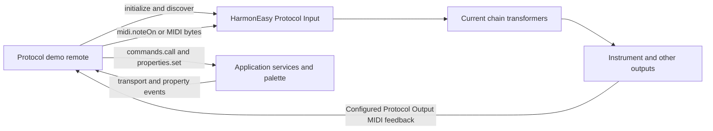

# Application integration

## Shared command registry

Keep handlers in application services. A command palette reads descriptors and calls `registry.call(id, args)`; remote peers invoke the same registry. Do not expose arbitrary DOM selectors or JavaScript evaluation. Use explicit setters such as `transport.setTempo` rather than toggles when remote callers need predictable results. Stable IDs are independent of translated labels, and command schemas document units and ranges.

Suggested application conventions (not mandatory protocol methods): `transport.get`, `transport.start`, `transport.stop`, `transport.setTempo`, `app.panic`, `graph.list`, `graph.addDevice`, `graph.removeDevice`, `graph.connect`, `device.getParameters`, `device.setParameter`, `preset.list`, and `preset.load`. Discover commands before using them: applications may expose different subsets. Publish `transport.changed` for tempo or playback changes, and `commands.changed` if availability changes. Retain state topics with `registry.retain('transport.changed', () => application.transport())` so clients can call `peer.subscribeState('transport.changed')` instead of subscribing and reading separately.

## audioBus

The Harmoneasy/audioBus integration adds `InputProtocol`, input ID `protocol`, and `setProtocolRegistry(registry)`. The Input uses the registered application commands by default, receives WebMidiLink MIDI through audioBus's standard converter, and releases held notes and sustain on disconnect. Multiple inputs can have separate peers while sharing the application registry.

```ts
import InputProtocol from 'audiobus/io/inputs/input-protocol'
import { setProtocolRegistry } from 'audiobus/io/protocol-registry'

setProtocolRegistry(applicationCommands)
const input = new InputProtocol() // listens immediately, without pairing
// Input commands flow through the ordinary graph routing.
// On teardown: input.destroy()
```

Open connections are the default. Windows that open or embed the application can initialize a session; legacy WebMidiLink MIDI needs no handshake. Multiple Inputs share one listener so application commands execute once while MIDI reaches each Input chain. Call `disconnect()` or `destroy()` to release held notes and remove listeners. Browser audio still needs a local click.

Pairing is optional under **Advanced connection settings**. To require it programmatically:

```ts
const input = new InputProtocol({ acceptUnpaired: false })
input.attach(remoteWindow, 'https://trusted-peer.example')
await input.connect()
// Pass { requirePairingCode: code } as attach's third argument when needed.
```

Use `autoConnect: false` to manage open listener startup yourself.

## audioBus Output

`OutputProtocol`, output ID `protocol`, sends a chain's transformed MIDI and can discover and invoke destination commands. It shares the application's command registry by default, enabling control in both directions. Its non-React panel supports explicit destination pairing, protocol mode, command discovery, and schema-generated argument forms.

```ts
import OutputProtocol from 'audiobus/io/outputs/output-protocol'

const output = new OutputProtocol()
output.attach(destinationWindow, 'https://trusted-peer.example')
await output.connect()
console.log(await output.discover())
await output.call('transport.setTempo', { bpm: 128 })
output.noteOn(60, 100, 1)
output.noteOff(60, 1)
output.destroy()
```

Use `{mode:'webmidilink'}` for a legacy synth; it skips control initialization and exposes no application commands. Patch helpers `requestPatch()` and `setPatch(data)` work in either mode; replies arrive through audioBus's `EVENT_PROTOCOL_PATCH`. `EVENT_PROTOCOL_EVENT` carries subscribed `{topic,data}` notifications. SysEx is opt-in with `allowSysex:true`. Disconnect sends sustain-off and tracked note-offs before removing listeners.

For desktop IPC or another isolated transport, use `output.attachTransport(transport)`. Custom transports must authorize their peer. See [receiver.html](../examples/receiver.html) for a destination that supports both modes, optional sound, MIDI logs, commands, and patches. Browser audio still requires a local user gesture.

## MIDI 2 and application contracts

Enable `ump:true` on participating peers and provide `onUmp(words)` at receivers. `supports('ump')` becomes true only after both peers advertise it. Use `sendUmp(words)` for exact unsigned 32-bit words; no byte MIDI conversion is performed in the SDK. Old peers without the capability retain their existing byte MIDI and command path. Group-aware addressing and note ownership belong to each application's MIDI routing layer.

The audioBus Protocol Input now dispatches UMP-backed commands, and its Output sends `command.ump` using the existing codec so untouched high-resolution values survive. `command.midiGroup` can retarget groups. Held notes and sustain are released in their original format, group and channel. Legacy destinations reject UMP by default. Explicit `allowMidi1Fallback:true` permits representable group-zero conversion, while nonzero groups and unsupported per-note messages still reject.

```js
registry.registerProperty({
  id: 'transport.tempo', title: 'Tempo', description: 'Internal tempo', unit: 'BPM',
  schema: { type: 'number', minimum: 10, maximum: 303 },
  get: () => application.bpm,
  set: value => application.setBpm(value),
  writable: () => application.ownsClock
})
await peer.connect()
console.log(await peer.listProperties())
await peer.subscribe('properties.changed')
await peer.setProperty('transport.tempo', 128)
```

Harmoneasy exposes tempo, playback-running and clock-source properties. Writable properties appear in its palette; the Output panel can discover/read/edit a destination's properties. The namespaced `org.audiobus.transport` version 1 bundle requires `transport.get`, `transport.setTempo`, `transport.start`, `transport.stop`, `app.panic`, plus `transport.tempo`, `transport.running`, and `transport.clockSource`. Other applications can register smaller custom bundles under different IDs and version their own contracts. These are application bundles rather than MIDI-CI Profiles; a native MIDI-CI adapter remains future work.

## Control Harmoneasy

Harmoneasy's audioBus Protocol input exposes everything a controller needs through discovery:

- application commands and properties: `transport.get`, `transport.setTempo`, `transport.start`, `transport.stop`, `app.panic`, and retained `transport.changed` state;
- MIDI commands that play into the input's chain: `midi.noteOn`, `midi.noteOff`, `midi.polyAftertouch`, `midi.channelAftertouch`, `midi.pitchBend`, `midi.controlChange`, `midi.programChange` and `midi.allNotesOff`, grouped as the `org.audiobus.midi` bundle;
- every control in its command palette: `ui.list` returns IDs, kinds, values and choices, `ui.activate` presses buttons and toggles, and `ui.setValue` sets choices, numbers and text.

Open the [full remote demo](../api/remote-control.html). It embeds the step-through song preset and connects automatically. Press **Start** inside HarmonEasy to enable audio. Choose **Remote control playground** for ordinary instrument playing, or **Step through a song** to advance the song with each incoming note. No Input URL, checkbox or Connect step is needed.

For an existing setup, add an **audioBus Protocol** Input to the chain you want to play, then use the app toolbar's **Remote** button. The remote discovers the current commands, properties, presets and palette controls rather than assuming a fixed graph. Open device panels and refresh the interface list to expose their controls.



A minimal controller for the same setup:

```js
import { Peer, windowTransport } from 'audiobus-protocol'

const harmoneasy = window.open('https://designerzen.github.io/harmoneasy/presets/protocol/remote-playground/', 'harmoneasy')
const peer = new Peer(windowTransport(harmoneasy, 'https://designerzen.github.io'), {
  identity: { name: 'My controller', version: '1' },
  timeoutMs: 15000 // initialization repeats until the input is listening
})
await peer.connect()
await peer.call('midi.noteOn', { note: 60, velocity: 100 })
await peer.call('midi.pitchBend', { value: 4096 })
await peer.call('midi.noteOff', { note: 60 })
const controls = await peer.call('ui.list', { query: 'reverb' })
if (controls[0]?.kind === 'action') await peer.call('ui.activate', { id: controls[0].id })
```

Harmoneasy deployments that send `Cross-Origin-Opener-Policy: same-origin` cut the link to an opening window; embed those in an iframe and use `iframe.contentWindow` instead. The demo embeds by default. Open control is on by default; choosing to require pairing is saved with the project. An arbitrary existing preset needs a Protocol Input to receive notes. MIDI feedback needs a Protocol Output configured for connected windows.

### Test a local or alternate deployment

Open `api/remote-control.html?app=http://localhost:1999/` on the protocol demo site to use a local HarmonEasy build. Quick-open preset buttons resolve against that app base. The address field also accepts a complete setup or preset URL. Build with `npm run build:site` and serve `_site/` over HTTP(S) for local SDK testing; `file://` origins are not supported.

| Test | Expected result |
| --- | --- |
| Open the remote and press Start in embedded HarmonEasy | Identity, transport and command lists populate automatically |
| Press Next note in the song preset | Song advances; configured Protocol Output sends resulting notes back |
| Open playground and play keyboard/drums | MIDI follows the current chain's transformations |
| Change tempo or a writable property | Actual state updates in both pages |
| Open a device panel, then refresh interface controls | Newly available controls appear with IDs and values |
| Load a remote-ready preset | Notes release, remote reconnects and discovers the new setup |
| Disable open connections in advanced settings | Open remote cannot reconnect until explicit pairing is configured |

### Follow the current setup instead of hard-coding it

Discover again after reconnecting. Command availability, writable properties and visible interface controls depend on the active setup; a remote should show only what it discovers. Interface IDs come from `ui.list`, not labels or guessed DOM selectors.

```js
const commands = await peer.discover()
console.table(commands.map(({ id, available }) => ({ id, available })))
const { state } = await peer.subscribeState('transport.changed')
console.log('Current transport:', state) // subsequent updates arrive in onEvent

if (peer.supports('properties')) {
  const properties = await peer.listProperties()
  const tempo = properties.find(p => p.id === 'transport.tempo' && !p.readOnly)
  if (tempo) await peer.setProperty(tempo.id, 128)
}
const controls = await peer.call('ui.list', { query: 'volume' })
const volume = controls.find(control => control.kind === 'number')
if (volume) console.log(volume.id, volume.value, volume.min, volume.max)
// Set a value within the returned range:
// await peer.call('ui.setValue', { id: volume.id, value: desiredValue })
```

```mermaid
sequenceDiagram
    participant R as Remote
    participant H as HarmonEasy
    R->>H: initialize (retried until Protocol Input exists)
    H-->>R: identity and capabilities
    R->>H: commands.list, properties.list, ui.list
    R->>H: subscribe transport.changed
    H-->>R: retained current transport state
    R->>H: presets.load with discovered preset ID
    H-->>R: result, then bye when old Input closes
    Note over R,H: Old held notes release; new setup creates its Input
    R->>H: initialize with a new Peer
    R->>H: rediscover commands, properties and controls
```

## OpenDAW and other applications

Install the package and implement a registry using that application's own services. Pass it into a `Peer`, then attach a window transport pointing to Harmoneasy's window. No audioBus dependency is necessary. The example named OpenDAW is a simulated integration peer; this repository does not modify OpenDAW or claim that OpenDAW already supports the protocol.

Use a stable window reference from an iframe or popup and an exact configured origin. An embedding host can use `iframe.contentWindow`; an embedded app can use `window.parent`. Install both listeners and coordinate readiness before calling `connect()`. For WebSocket or desktop IPC, supply an authenticated transport implementation instead of relaxing window origin checks.
